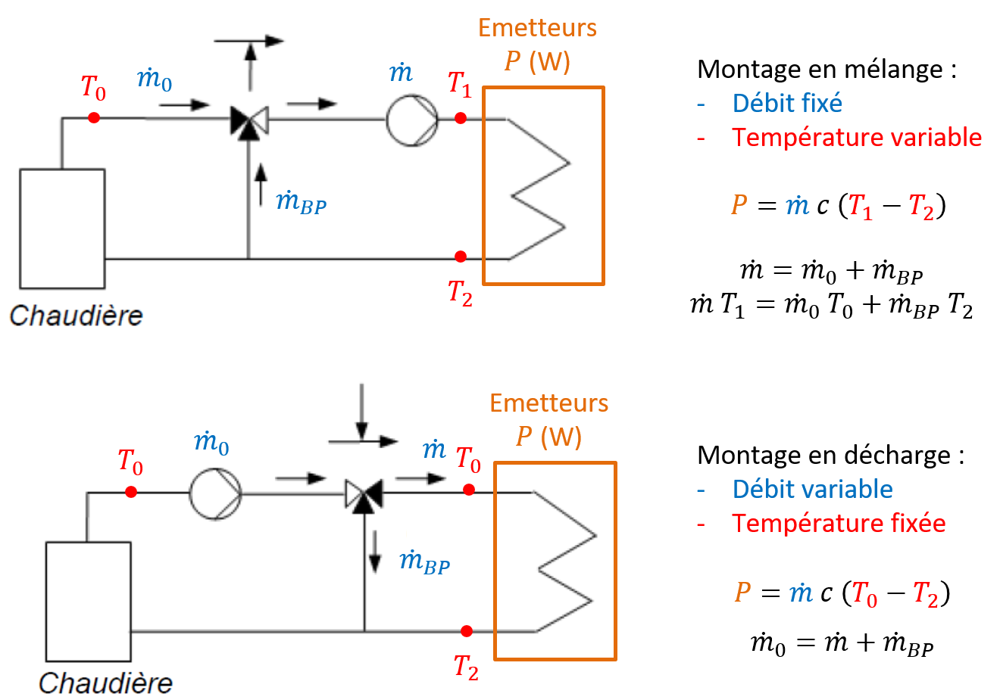
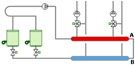
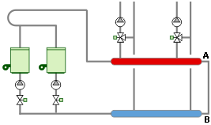
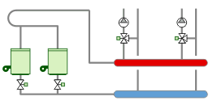
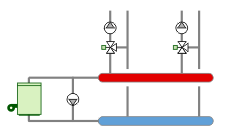
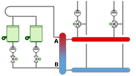

# sources

https://energiebatiment.com/chauffage-hydronique.html#distribution

https://energieplus-lesite.be/techniques/chauffage10/chauffage-a-eau-chaude/circuits-hydrauliques-primaires/

# montage des vannes 3 voies en mélange ou décharge

# boucle fermée

# boucle ouverte

# avec bouteille casse pression

